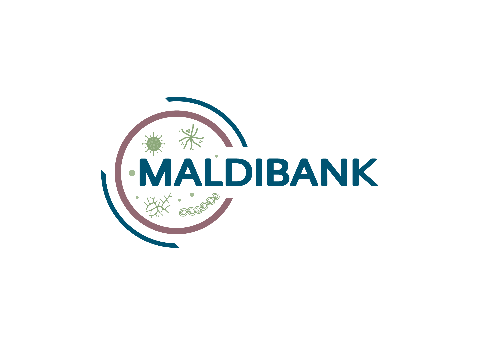

# Welcome to the MALDIBANK E-Learning Course

{ width="320" }

The **MALDIBANK** project aims to create a global, cloud-based, open-access platform for microbial MALDI-TOF MS spectra, improving the identification of microorganisms.

Learn more about the project at [maldibank.eu](https://maldibank.eu/).

## Course modules

1. [Introduction, Safety & Materials](modules/module-1.md)
2. [Sample Prep — Yeast & Filamentous Fungi](modules/module-2.md)
3. [Sample Prep — Bacteria](modules/module-3.md)
4. [Preparing the MALDI-TOF Target Plate](modules/module-4.md)
5. [Cleaning Reusable Target Plates](modules/module-5.md)

Work through the modules in order using the navigation on the left.

---

**🔒 Confidentiality Notice**
All responses will be treated with strict confidentiality. Your answers will be analyzed in aggregate, and no personally identifiable information will be shared or published. Participation is entirely voluntary.

**Disclaimer**
The MALDIBANK project is funded by the European Union under Grant Agreement no. 101188201. This course reflects only the author's view and the European Commission is not responsible for any use that may be made of the information it contains.
